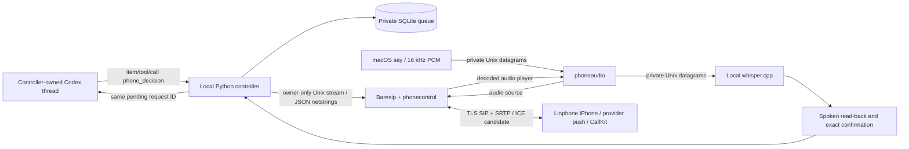

# Architecture

## Current experimental cloud conversation path

The pending original Codex RPC remains attached to the existing controller. A
separate Python 3.12 worker uses LiveKit Agents custom audio IO directly over the
private Baresip PCM sockets, without a WebRTC room or new public server. Cloud
AssemblyAI STT → bounded Gemma dialogue → Fish TTS streams both directions.
Local VAD detects speech only. A proposal needs a subsequent explicit spoken
confirmation before the worker can return it. Original thread/turn/deadline
checks remain in the controller. Local Whisper/say is disabled for calls.
See [limits, setup and privacy](docs/CLOUD-VOICE.md).

## Historical v1 path (not the current call backend)

Python uses standard-library asyncio, SQLite, Unix sockets and subprocess argument lists.
No HTTP server or public control listener is used. The custom native phonecontrol module
provides owner-only Unix control, using documented Baresip command/event APIs. Its wire format
matches the inspected ctrl_tcp JSON/netstring contract, with only dial, hangup, accept and reginfo
commands supported. We replaced ctrl_tcp because loopback TCP alone does not authenticate
other users on the same Mac. accept is used only by the loopback test; production incoming calls
are immediately rejected.

phoneaudio is an independent Baresip driver, built against locally installed 4.12 headers.
It supplies 16 kHz mono signed 16-bit PCM frames every 20 ms. G.711 is resampled by Baresip.
The receive side reads actual decoded SIP audio; the transmit side never uses Mac speakers.
A half-duplex conversation avoids acoustic echo. Python only transcribes after speaking ends.
Silence detection is a fixed RMS gate plus a 1.3-second pause, not a learned VAD.

States: IDLE, DIALING, RINGING, CONNECTED, SPEAKING, LISTENING, PROCESSING, CONFIRMING,
ENDING, FAILED. SQLite stores call UUID, linked question UUID, session/thread ID, turn ID,
RPC request ID, timestamps, deadline and status. One asyncio lock serializes phone calls;
multiple threads retain separate pending requests. One automatic attempt; one explicit retry
(maximum two calls per question). No automatic redial on rejection or service restart.

A product/design dynamic tool blocks the real Codex turn. The response is a structured text
item on its original JSON-RPC request. Completed/interrupted/resolved/disconnected requests
are invalidated; late and duplicate answers are refused. A 15-minute deadline interrupts
an unresolved turn instead of sending a fabricated decision. On service restart, unresolved
requests are marked ORPHANED; recovery requires explicit resume in the same owned thread.
This does not claim transparent crash continuation of an already pending RPC request.

Provider interoperability, TLS/SRTP negotiation, ICE behavior and iPhone push still require
real account/device tests. Local SIP tests do not prove these external paths.
